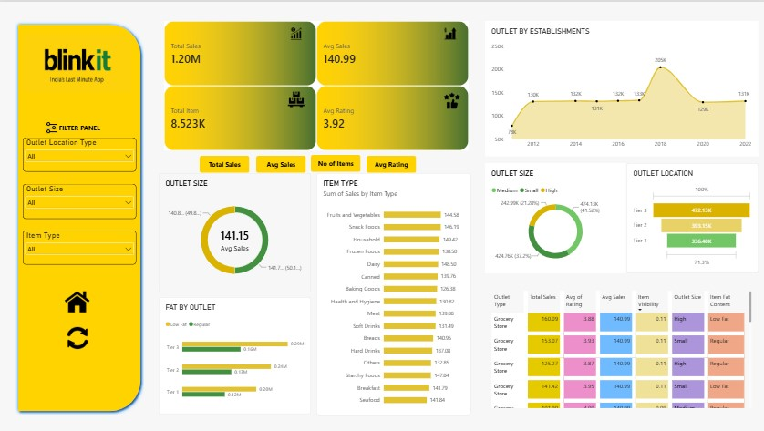

# 🛒 Blinkit Dashboard Using Power BI

## 📊 Project Overview

The **Blinkit Dashboard Using Power BI** is a data analytics project designed to analyze grocery sales performance, product distribution, and outlet characteristics using interactive visualizations.

The dashboard provides meaningful insights into sales trends and business performance to support data-driven decision-making.

## 🖼️ Dashboard Preview



## 🎯 Project Objectives

- Analyze overall sales performance and key business metrics.
- Understand sales distribution across product categories.
- Compare outlet performance by size, location, and establishment year.
- Analyze the impact of product fat content on sales.
- Identify trends and patterns to support business decisions.

## 🛠️ Tools & Technologies

- **Power BI Desktop** – Dashboard development and visualization
- **Power Query** – Data cleaning and transformation
- **DAX** – Measures and calculated metrics
- **Excel / CSV** – Data storage and preparation

## 📈 Key Performance Indicators (KPIs)

- **Total Sales** – Overall revenue generated
- **Average Sales** – Average sales value
- **Number of Items** – Total items represented in the dataset
- **Average Rating** – Average customer rating

## 📊 Dashboard Features

- **Sales Analysis:** Overall sales performance and trends.
- **Product Analysis:** Sales by item type and fat content.
- **Outlet Analysis:** Performance comparison by outlet type and size.
- **Location Analysis:** Sales distribution across outlet locations.
- **Establishment Trends:** Analysis of sales by outlet establishment year.
- **Interactive Filters:** Explore data using dashboard slicers.

## 🔍 Key Insights

The dashboard helps identify:

- Top-performing product categories.
- Differences in sales across outlet types and sizes.
- Sales distribution by product characteristics.
- Trends in outlet performance over time.
- Opportunities to improve sales and product distribution.

*Add specific numerical findings based on your dashboard results.*

## 📁 Project Structure

```text
Blinkit-Dashboard-Using-Power-BI/
│
├── images/
│   └── blinkit-dashboard.png
│
├── Blinkit-Dashboard.pbix
├── dataset.csv
└── README.md
```

*Update filenames to match your actual repository files.*

## 🚀 How to Use

1. Clone or download this repository.
2. Install [Microsoft Power BI Desktop](https://powerbi.microsoft.com/desktop/).
3. Open the `.pbix` file.
4. Update the dataset path if required.
5. Refresh the data and explore the dashboard.

## 💡 Skills Demonstrated

- Data cleaning and transformation
- Data visualization and modeling
- DAX calculations and KPI development
- Business intelligence and sales analysis
- Interactive dashboard design
- Data-driven decision-making

## 👨‍💻 Author

Created as a data analytics project using Microsoft Power BI.

## ⭐ Acknowledgements

This project is for educational and analytical purposes. Blinkit is a trademark of its respective owner. This project is not affiliated with or endorsed by Blinkit.

---

If you find this project useful, consider giving the repository a ⭐!
